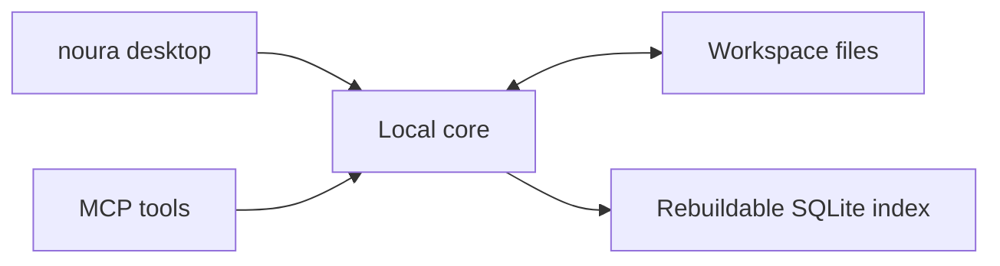

# noura

The open workspace for humans and AI.

noura is an open-source, local-first desktop workspace for notes, tasks, projects, and AI chat. Your work stays in ordinary files you can edit, back up, and use without noura.

[](#try-noura) [](https://github.com/lobbystack/noura/actions/workflows/ci.yml) [](LICENSE)

[Try noura](#try-noura) · [Documentation](#documentation) · [Contribute](#contributing)

## A workspace built from plugins

Files and the Markdown editor are always on. Tasks, projects, calendar, and AI are first-party plugins. Each runs as a WebAssembly component with only the capabilities you approve, and you turn plugins on for each workspace in **Settings** > **Plugins**.

Turning a plugin off leaves its files in place. You can also install plugins from a folder or from GitHub, or [write your own](docs/plugins/README.md) in TypeScript or Rust.

## Work in one workspace

Write project notes, track tasks, and give your AI assistant context from the same workspace:

- **Notes**: write and edit Markdown, and open PDFs and images beside them
- **Tasks and projects**: track priorities, due dates, and progress on project boards
- **Calendar**: view scheduled work by month, week, or day
- **Search**: find content across your workspace with full-text search
- **AI chat**: connect your provider, allow it to read workspace content, and approve each tool call
- **External AI tools**: read and update notes and tasks through the [Model Context Protocol (MCP)](https://modelcontextprotocol.io/docs/getting-started/intro). noura doesn't ask before each MCP action, so connect only tools you trust.

## Keep control of your work

Use noura alongside your existing tools:

- **Open files**: notes, tasks, projects, and chat history stay Markdown files with structured metadata
- **Local use**: read and edit your workspace offline, without an account or hosted service
- **External editing**: edit, move, and rename files with other tools, and review conflicts when changes overlap
- **AI permissions**: choose your provider, and allow it to read workspace content before the first request
- **Credentials**: noura keeps provider keys in your operating system's credential store
- **Sync**: turn on end-to-end encrypted sync for a workspace with a [sync server](docs/self-hosting.md), which stores ciphertext and the metadata it needs to route it

## Try noura

Download the installer for macOS, Windows, or Linux from [noura.app](https://noura.app/#download) or the [releases page](https://github.com/lobbystack/noura/releases). noura is an early alpha, so keep backups of important files.

### Run noura from source

Install these tools first:

- **[rustup](https://www.rust-lang.org/tools/install)**: it installs the Rust version that `rust-toolchain.toml` pins
- **[NASM](https://nasm.us) 2.14 or newer**, on an Intel or AMD computer only: the AVIF decoder assembles its x86 code with it. Run `brew install nasm`, `sudo apt-get install nasm`, or `choco install nasm`, and make sure it's on your `PATH`.
- **Git Bash**, on Windows only: it runs the repository's scripts

Clone the repository, install the pinned toolchain with its WebAssembly target, build the plugins that ship with noura, and start the app:

```sh
git clone https://github.com/lobbystack/noura.git
cd noura
rustup toolchain install
rustup target add wasm32-wasip2
scripts/build-shipped-plugins.sh
cargo run -p desktop
```

`scripts/build-shipped-plugins.sh` builds the Tasks, Projects, Calendar, and AI plugins into `apps/desktop/packaging/plugins`, and `cargo run` loads them from there.

Create a workspace, add a note, and open the note's Markdown file in your editor.

## Develop noura

Run the checks CI runs from the repository root:

```sh
cargo fmt --all --check
cargo clippy --workspace --all-targets --all-features --locked -- -D warnings
cargo test --workspace --locked
cargo deny check
```

Some plugin tests load the plugins as WebAssembly components and skip themselves when the components are missing. Build them first with `crates/plugin-sdk/build-plugins.sh`. Follow the [contributor guide](CONTRIBUTING.md) for the rest of the checks, and the [desktop verification guide](docs/testing/local-alpha-acceptance.md) for the manual workflows.

The TypeScript plugin kit in `sdk/typescript` uses Node and npm. The marketing website uses [Bun](https://bun.sh/docs/installation). To work on the website, install its packages and start its development server:

```sh
bun install
bun run dev:website
```

Then open `http://127.0.0.1:5174` in your browser.

## How noura stores your workspace

Your workspace is a folder with a [manifest](docs/workspace-format/v1.md#manifest) at `.noura/workspace.yaml`. Notes, tasks, projects, and chats use Markdown with structured metadata in [frontmatter](docs/workspace-format/v1.md#managed-markdown). You can move or rename a file without changing its stable identifier.

noura writes workspace files to disk before it reports a change as saved. You can delete its SQLite search index and metadata cache, and noura rebuilds them from those files. The desktop app and the MCP server use the same Rust services:



Read the [workspace format](docs/workspace-format/v1.md) for file layouts and the [local-core architecture](docs/architecture/local-core.md) for write and recovery behavior.

## Repository structure

Start with the directory for the part you want to work on:

| Directory | Purpose |
| --- | --- |
| [`apps/desktop`](apps/desktop) | The desktop binary: windows, menus, drag and drop, packaging, and updates |
| [`apps/website`](apps/website) | Marketing website and legal pages for noura.app |
| [`crates/app-core`](crates/app-core) | Product behavior and view state, with no UI dependency |
| [`crates/app-ui`](crates/app-ui) | egui screens and the widget kit that draws plugin views |
| [`crates/editor-core`](crates/editor-core), [`crates/editor-egui`](crates/editor-egui) | The Markdown editor's buffer and parsing, and the egui editor that draws it |
| [`crates/local-core`](crates/local-core) | File operations, validation, indexing, watching, and credentials |
| [`crates/workspace-format`](crates/workspace-format) | Parsing, validation, and canonical serialization of workspace files |
| [`crates/plugin-host`](crates/plugin-host), [`crates/plugin-sdk`](crates/plugin-sdk) | The Wasmtime plugin host, and the WIT interfaces with the Rust author library |
| [`crates/plugins`](crates/plugins) | First-party plugins: AI, calendar, projects, tasks, and a hello sample |
| [`crates/mcp-server`](crates/mcp-server) | MCP adapter over the shared services |
| [`crates/collab-sandbox`](crates/collab-sandbox), [`crates/collab-sandbox-guest`](crates/collab-sandbox-guest) | The sandbox that checks and applies collaborative text edits |
| [`crates/sync-protocol`](crates/sync-protocol), [`crates/sync-key-envelope`](crates/sync-key-envelope) | Sync wire types, signing, key envelopes, and device formats |
| [`crates/sync-server`](crates/sync-server), [`crates/sync-store`](crates/sync-store), [`crates/sync-store-sqlite`](crates/sync-store-sqlite), [`crates/sync-store-postgres`](crates/sync-store-postgres) | The sync service and its SQLite and PostgreSQL stores |
| [`crates/account-web`](crates/account-web) | WebAssembly module for passkey sign-in and the encrypted share viewer |
| [`crates/spell-check`](crates/spell-check) | The system spell checker on macOS and Windows |
| [`crates/kit-host`](crates/kit-host), [`crates/live-tests`](crates/live-tests) | Test drivers for the TypeScript kit and for two desktops syncing |
| [`sdk/typescript`](sdk/typescript) | The TypeScript plugin author kit |
| [`docs`](docs) | Workspace format, architecture, plugin, and security documentation |
| [`scripts`](scripts) | Build, packaging, and check scripts |

## Documentation

Start with the [documentation guide](docs/README.md), or use these references for implementation details:

- [Workspace format](docs/workspace-format/v1.md)
- [Local-core architecture](docs/architecture/local-core.md)
- [AI runtime and permissions](docs/architecture/ai-runtime.md)
- [Plugin runtime](docs/architecture/plugin-runtime.md)
- [Plugin author guide](docs/plugins/README.md)
- [Desktop verification guide](docs/testing/local-alpha-acceptance.md)
- [Sync server self-hosting](docs/self-hosting.md)

## Contributing

Read the [contributor guide](CONTRIBUTING.md) and the [conventions](AGENTS.md) reviewers enforce before changing code. Keep pull requests focused, include tests for behavior changes, and run the development checks.

For workspace-format changes, update the shared [conformance fixtures](docs/workspace-format/fixtures/) in the same commit.

## Support and security

Use [GitHub issues](https://github.com/lobbystack/noura/issues) for questions, bug reports, and feature requests. For anything else, email [hello@noura.app](mailto:hello@noura.app). Follow the [security policy](SECURITY.md) to report a vulnerability.

## License

noura uses the [MIT license](LICENSE). See [third-party notices](THIRD_PARTY_NOTICES.md) for dependency attributions.
